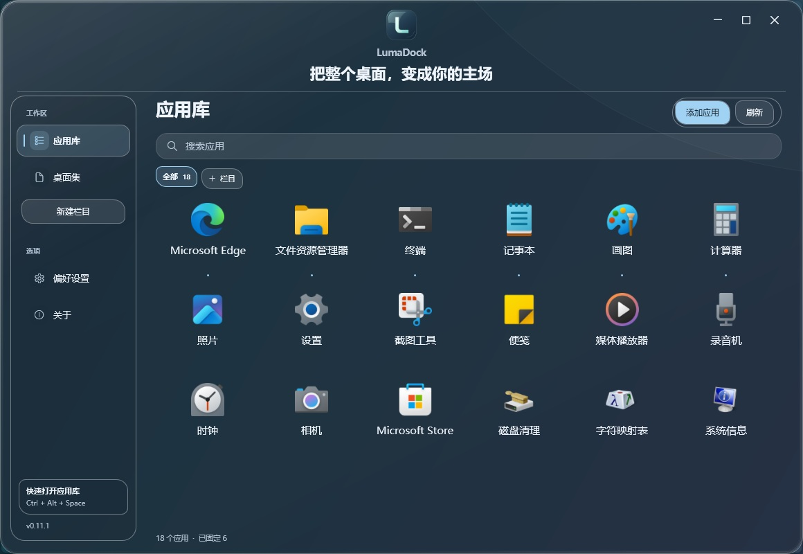
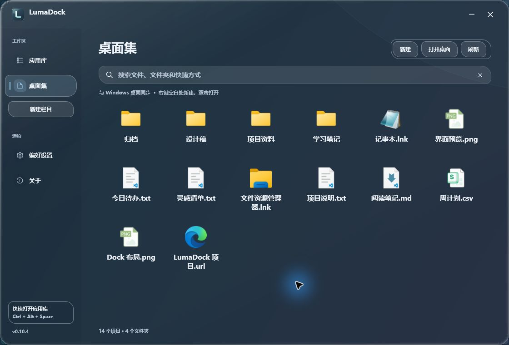
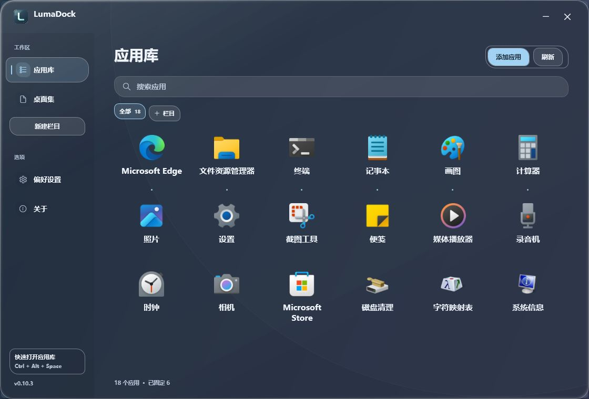
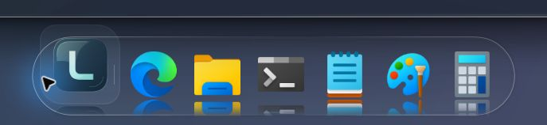

<p align="center">
  
</p>

<p align="center"><b>把整个桌面，变成你的主场</b></p>
<p align="center">
  <a href="https://github.com/FouHe0720/LumaDock/releases/tag/v0.11.2"></a>
  
  <a href="https://github.com/FouHe0720/LumaDock/actions/workflows/build.yml"></a>
  <a href="LICENSE"></a>
</p>
<p align="center">
  <a href="https://github.com/FouHe0720/LumaDock/releases/download/v0.11.2/LumaDock-0.11.2-win-x64.zip"></a>
</p>
<p align="center">完整解压即可运行 · 自带 .NET Runtime · 无需管理员权限 · 预发布</p>
<p align="center">
  <a href="docs/USER-GUIDE.md">使用指南</a> ·
  <a href="docs/RELEASE-0.11.2.md">本次更新</a> ·
  <a href="docs/DEVELOPMENT.md">开发文档</a> ·
  <a href="docs/performance.md">性能记录</a>
</p>

LumaDock 是一款原生 Windows Dock 与桌面管理工具。把常用软件和文件夹放进通透的底座，再把底座拖到顺手的位置。应用库用来找软件，桌面集用来打开和整理桌面上的文件、文件夹与快捷方式。

<table>
  <tr>
    <td width="33%" valign="top"><b>位置，随手安排</b><br><br>拖住握柄或底座空白处，自由移动 Dock。末端拉一拉，图标和底座一起缩放；松开后记住位置与尺寸。</td>
    <td width="33%" valign="top"><b>工作台，更从容</b><br><br>居中的品牌区、独立侧栏与清楚的内容层次。窗口可从边缘拉伸，也能最大化展开。</td>
    <td width="33%" valign="top"><b>常用文件夹，也进 Dock</b><br><br>将实际文件夹拖到底座，或在桌面集中右键固定。点击直接打开，原目录与文件保留。</td>
  </tr>
</table>

## 0.11.2 · 移到哪，就停在哪

Dock 改用自己的鼠标拖动处理，任务栏所在区域也可以放。移动时跟随指针，松手后保存落点；应用图标继续用于启动和排序。

底座右端增加缩放握柄，竖向摆放时位于下端。沿底座方向或向外侧拖动，图标与底座会一起连续变大、变小，范围为 **24–160 DIP**。缩放以可见底座中心为基准；按 **Esc** 可取消本次移动或缩放，恢复开始时的位置与尺寸。

预览复用已有图标和控件，松手后再保存并按当前尺寸请求系统图标。拖动中不会反复写配置，也没有新增常驻的鼠标检查。

## 熟悉的工作台

Logo、LumaDock 名称与项目介绍分别居中，三项之间留出更舒展的间距。介绍语仍是 **“把整个桌面，变成你的主场”**，应用库与桌面集保留熟悉的导航位置。


<p align="center"><sub>0.11.1 工作台界面参考 · 品牌、导航与应用网格在新版保留。</sub></p>

把常用的本机文件夹，或指向它的快捷方式拖入 Dock，在任意两个图标之间松开即可固定。也可以在桌面集中右键文件夹 → **固定到 Dock**。点击后由 Windows 打开实际目录，原目录与内容不复制、不移动；应用库仍专注软件清单。

在 **偏好设置 → 应用整理 → 每行应用数** 中选择布局密度。保留 4～10 个的选项，新增 **12、14、16、18、20 个**。20 个是上限，需要足够宽的窗口；缩小窗口或增大名称字号时，仍按可读空间减少实际列数。拖动窗口边缘或四角可调整大小，右上角可最大化与还原。

自由摆放的 Dock 可以进入任务栏所在区域。拖住握柄或底座空白处，移到顺手的位置后松开，位置便会保存；刷新、重启或改变底座尺寸后，仍按所选屏幕恢复。四边停靠继续沿系统工作区摆放。

Dock 保持普通窗口层级；Windows 任务栏若处于上方，会遮住重叠部分。软件不会隐藏任务栏或改变它的设置。需要找回 Dock 时，按 **Ctrl + Alt + Space**，在 **偏好设置 → Dock → 恢复位置** 回到底部居中。

在 **摆放方式** 中切换自由摆放与四边停靠。双击握柄／底座空白处也能恢复位置；图标自身的拖动继续用于排序。

## 真实桌面，继续顺手

桌面集现在读取当前用户和公共桌面的实际内容。文件夹、文档、图片和快捷方式一起展示，使用 Windows 提供的真实图标；同一项目只出现一次，同名但位置不同的文件分别保留。

双击打开文件夹或文件；在空白处右键，新建文件夹或文本文档。选中项目后可以重命名、复制或复制路径，也可以将剪贴板中的文件复制到桌面。新建和重命名会作用于实际桌面，同名项目不会被覆盖。


<p align="center"><sub>0.10.4 桌面集界面参考 · 文件与文件夹功能在新版工作台中保留。</sub></p>

桌面集可见时监听文件变化，短暂合并变更后更新；离开这一页便停止监听，不持续扫描。应用库继续专注软件清单，自建栏目、固定顺序、字体和 Dock 外观保留。

### 应用和文件，各有去处


<p align="center"><sub>0.10.3 应用库界面参考 · 三排布局与快速启动提示继续保留。</sub></p>

应用库汇集已发现与手动添加的程序，支持搜索、多选添加和自建栏目。桌面集按实际路径展示文件，不把同名文档合并成一个项目。文件夹复制、其他文件模板及完整系统文件菜单可点击“打开桌面”使用资源管理器。

Dock 延续普通窗口层级。打开其他软件时，工作窗口在上方；返回桌面使用 Dock，或按 **Ctrl + Alt + Space** 打开应用库。

## 通透底座，清楚倒影

圆润的胶囊、交错的卵石、利落的轨道。当前图标随指针放大、向内抬起，相邻图标轻轻让位；停稳后动画收住。


<p align="center"><sub>0.10.3 Dock 界面参考 · 真实指针悬停与 90% 倒影，外观设置在新版中保留。</sub></p>

在 **偏好设置 → Dock** 调整悬停、倒影与图标鲜艳度；在 **材质** 调整主题、强调色、浓度和图标密度。倒影强度上限提高到 **95%**，新配置默认 50%；底座浓度可低至 **2%**，图标本身保持清楚。既有偏好继续保存，按自己的壁纸明暗调整即可。

默认 **动态透景 · 清透** 由系统合成后方画面。偏爱柔和的背景，可以选择磨砂；需要减少动效，可以关闭流光或开启省电模式。支持条件见 [材质说明](docs/WINDOW-BACKDROP.md)。

**潮蓝 · 青瓷 · 琥珀 · 烟紫 · 玫瑰 · 石墨**，六款强调色用于按钮、选中状态和玻璃边缘。字体可跟随 Windows 图标设置，也可以在 LumaDock 中单独选择家族、加粗、斜体和文字颜色。[字体设置范围 →](docs/SYSTEM-FONTS.md)

## 三步开始

1. [下载 Windows 便携版](https://github.com/FouHe0720/LumaDock/releases/download/v0.11.2/LumaDock-0.11.2-win-x64.zip)，**完整解压**到准备长期保留的可写文件夹。
2. 双击 **LumaDock.exe**，等待首次扫描。便携包包含 .NET Desktop Runtime，普通使用无需 SDK、IDE、字体包或额外主题工具。
3. 点击 Dock 左端的 L 图标，或按 **Ctrl + Alt + Space** 打开应用库。右键常用应用 → **固定到 Dock**；未扫描到的程序通过“添加应用”选择路径。

`source.zip` 和 GitHub 自动生成的 Source code 供开发使用。源码构建需要 Windows x64 与 [.NET 10 SDK](https://dotnet.microsoft.com/download/dotnet/10.0)：

```powershell
git clone https://github.com/FouHe0720/LumaDock.git
cd LumaDock
.\scripts\build.ps1
.\scripts\test.ps1
.\scripts\start.ps1 -Launchpad
```

[完整构建与发布步骤 →](docs/DEVELOPMENT.md)

## 常用操作

| 想做什么 | 从这里开始 |
| --- | --- |
| 快速启动应用 | 点击 Dock 左端 L 图标，或按 **Ctrl + Alt + Space** 打开应用库 |
| 调整工作台大小 | 拖窗口边缘或四角；右上角可最大化与还原 |
| 设置每行应用数 | **偏好设置 → 应用整理**，最高 20 个，按窗口宽度自适应 |
| 移动整个 Dock | 拖移动握柄或底座空白处，松开保存位置；自由摆放可进入任务栏区域 |
| 改变 Dock 与图标大小 | 拖右端缩放握柄；竖向摆放时拖下端，连续调整至 24–160 DIP |
| 取消本次移动或缩放 | 松手前按 **Esc**，回到操作前的位置与尺寸 |
| 恢复 Dock 到屏幕底部 | 双击握柄／底座空白处，或 **偏好设置 → Dock → 恢复位置** |
| 查看桌面的文件与文件夹 | 左侧 **桌面集**，搜索名称，双击打开 |
| 新建桌面文件夹或文本 | 桌面集空白处右键 → **新建**，保存到真实用户桌面 |
| 重命名桌面项目 | 选中项目后按 **F2**，或使用右键菜单 |
| 将文件复制到桌面 | 复制文件后，在桌面集空白处右键 → **粘贴文件副本**；文件夹在资源管理器中复制 |
| 查看完整的 Windows 文件操作 | 桌面集 → **打开桌面** |
| 添加未扫描到的软件 | **添加应用**，选择程序或快捷方式；支持多选 |
| 将程序或文件夹插到两个图标中间 | 拖到 Dock 的插入标记处，松开即可 |
| 固定桌面上的文件夹 | 桌面集右键文件夹 → **固定到 Dock**，也可直接拖入 |
| 把 Dock 应用放到桌面 | 拖到 Windows 桌面创建快捷方式，原文件和固定状态保留 |
| 选择其他启动参数 | 右键应用或 Dock 图标 → **启动方式** |
| 更换应用图标 | 右键 → **更换图标…**，可随时恢复原图标 |
| 建立自己的栏目 | **新建栏目**，拖入应用；右键栏目可改名或删除 |
| 调整悬停、倒影与鲜艳度 | **偏好设置 → Dock** |
| 调整玻璃、轮廓与颜色 | **偏好设置 → 材质** |
| 调整字体、粗细与文字颜色 | **偏好设置 → 字体与文字** |
| 选择第二块屏幕 | **偏好设置 → Dock → 显示器** |
| 设置开机启动 | **偏好设置 → 性能与启动**，主动启用并确认 |
| 完全退出 | Dock 空白处或托盘菜单 → **退出 LumaDock** |

应用库中的重复入口按可验证的目标和系统身份整理。同一本地应用的不同启动方式收在一张卡片的右键菜单，原始参数与工作目录保留。应用扫描读取开始菜单、桌面快捷方式与 AppsFolder 注册入口；未注册的便携软件需要手动添加。桌面集只枚举桌面顶层，不递归读取文件夹内容，也不遍历整块磁盘。

## 轻量驻留

**C# · .NET 10 LTS · WPF · Windows Shell。** 窗口状态由事件更新，图标异步读取并使用有界缓存；真实倒影复用已有图像，鲜艳度处理结果也会缓存。

指针停稳后，悬停和边缘流光停止动画。运行标记保持静态显示，不靠持续闪烁吸引注意。没有大型浏览器运行时，也没有额外后台服务。

**0.11.2 本机实测：** 常规 58 DIP Dock 静置时，平均全机 CPU **0.00802%**，私有工作集峰值 **49.7 MB**；160 DIP 大图标为 **53.4 MB**；最大化、每行 20 个的应用库前台静置为 **94.7 MB**，平均全机 CPU **0.00553%**。

三轮使用同一最终程序，各固定 2 个程序与 1 个实际文件夹，倒影 90%、底座浓度 4%。分别预热 20、20、120 秒后请求采样 30 秒；宽网格轮全程为 2560×1392、96 DPI 且处于前台。私有工作集与总工作集、私有提交不同，完整数值和条件见记录；短测不代表持续操作、所有设备或过夜驻留。

本版通过 **353 项组件与 WPF 检查**，另有 **14 组批量导入、100 轮窗口生命周期**。实际鼠标对照验证了任务栏落点、松手保存、放大缩小与独立进程恢复。[查看检查范围 →](docs/validation.md)

性能数字来自 Windows 实测，报告保留采样条件与程序集校验值。短测、交互检查与长期驻留的边界分别记录，见 [性能记录](docs/performance.md) 和 [验证范围](docs/validation.md)。

## 数据与退出

配置和轮转日志保存在 `%LOCALAPPDATA%\LumaDock`。导出、导入和恢复默认值位于 **偏好设置 → 数据**。软件不主动上传配置、应用清单或本地路径。

本版沿用配置格式 2。升级前可导出备份，原有固定项、自选图标与自建栏目继续使用。开机启动通过当前用户启动文件夹中的快捷方式实现，启用前确认。

卸载时先关闭开机启动、退出软件，再移除解压文件夹和 LumaDock 快捷方式。需要保留整理结果时保留数据目录。[完整退出、卸载与桌面恢复步骤 →](docs/USER-GUIDE.md#9-桌面图标恢复与卸载)

遇到问题，欢迎提交 [Issue](https://github.com/FouHe0720/LumaDock/issues)，写明版本、系统、缩放比例与复现步骤；分享截图或日志前请移除私人信息。

源码采用 [MIT License](LICENSE)。发行包附带微软 .NET Runtime 许可与第三方声明；运行时读取的应用名称与图标归各自所有者所有。
