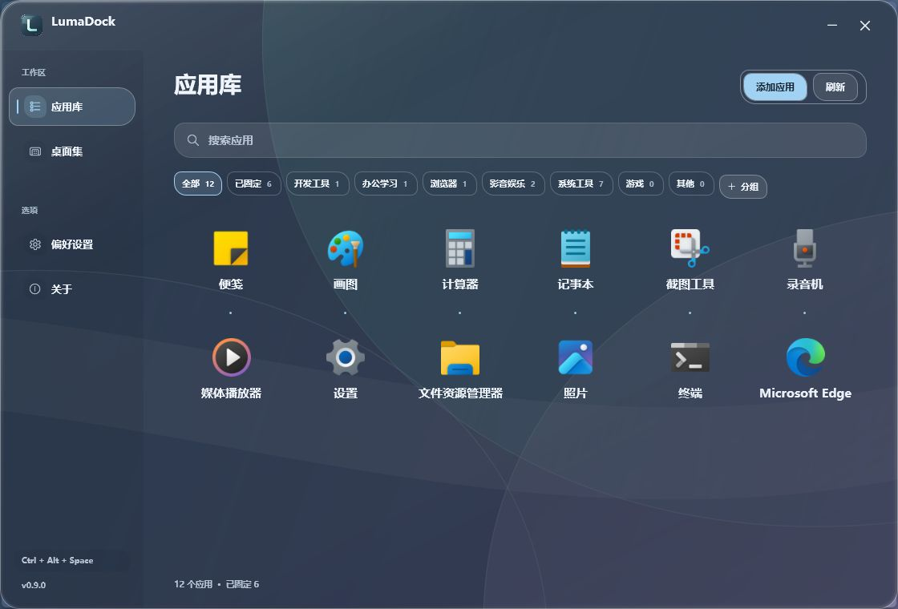
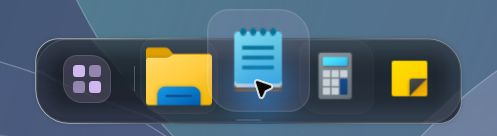
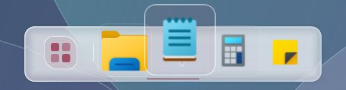
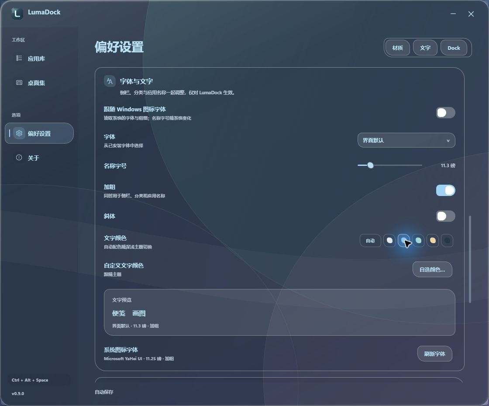

  

<h1 align="center">LumaDock</h1>

把常用应用留在顺手的位置。

  
  
  
  

  <a href="https://github.com/FouHe0720/LumaDock/releases"><b>下载 Windows 版</b></a> ·
  <a href="docs/USER-GUIDE.md">使用指南</a> ·
  <a href="docs/DEVELOPMENT.md">开发文档</a>

LumaDock 是一款原生 Windows Dock 与应用管理器。悬浮 Dock 放置常用入口，应用库集中查找和整理软件；玻璃、颜色和名称字体都可以按习惯调整。

0.9 实际 WPF 界面，使用系统应用与独立示例背景；应用内容、文字与材质随设置变化。

查看浅色界面

## 功能一览

| 常用入口 | 应用整理 | 外观与文字 |
| --- | --- | --- |
| 悬浮 Dock、任意位置插入、真实运行指示 | 应用搜索、虚拟分组、重复入口合并 | 系统实时透景、静态折射、短暂流光 |
| 与桌面双向拖入快捷方式 | 新增路径、固定到 Dock、隐藏记录 | 六种强调色、自选字体、粗细与文字颜色 |
| 三种轮廓、自动隐藏、四边停靠 | 排列与分类自动保存 | 更换应用图标、深浅主题与即时预览 |

采用 C#、.NET 10 LTS、WPF 与 Windows Shell。界面使用原生桌面技术，不依赖浏览器运行时或后台服务。动态透景交给系统合成，不在应用中循环截取壁纸；图标停稳后停止动画。

## 下载后直接运行

1. 打开 [Releases](https://github.com/FouHe0720/LumaDock/releases)，下载名称以 **`win-x64.zip`** 结尾的便携包。
2. **完整解压**到可写、准备长期保留的文件夹。
3. 双击 **`LumaDock.exe`**。首次扫描完成后，Dock 和应用库即可使用。

便携包包含 .NET Desktop Runtime，**无需另外安装 .NET、SDK、IDE、字体包或主题包**。普通使用不需要管理员权限。`source.zip` 与 GitHub 的 “Source code” 用于开发，不是可直接运行的程序包。

目标平台为 Windows 10 / 11 x64，推荐 Windows 11。不同系统的玻璃效果会按支持条件回退；当前仍为预发布版本，兼容性覆盖见 [验证记录](docs/validation.md)。

## 五分钟上手

| 想做什么 | 从这里开始 |
| --- | --- |
| 打开应用库 | 点击 Dock 最左侧图标，或按 **Ctrl + Alt + Space** |
| 放入常用软件 | 在应用库右键软件 → **固定到 Dock** |
| 插到两个图标之间 | 拖到 Dock 中的目标位置，看到插入标记后松开 |
| 把 Dock 应用放回桌面 | 将图标拖到 Windows 桌面，创建快捷方式，Dock 固定状态保留 |
| 添加未扫描的软件 | 点击 **添加应用**，选择程序或快捷方式 |
| 分类与排序 | 新建分组，将应用拖到分组标签；拖到另一应用前调整顺序 |
| 换配色和玻璃 | **偏好设置 → 材质** |
| 换应用图标 | 右键应用 → **更换图标…**；可随时 **恢复原图标** |
| 换 Dock 轮廓与悬停幅度 | **偏好设置 → Dock** |
| 调整字体和文字颜色 | **偏好设置 → 字体与文字**，选择系统跟随或独立样式 |
| 选择第二块屏幕 | **偏好设置 → Dock → 显示器** |
| 完全退出 | 托盘菜单 → **退出 LumaDock** |

**应用库**汇集开始菜单、注册应用、桌面和手动添加的应用；**桌面集**单独呈现桌面应用快捷方式。两页可以显示同一软件，分组与固定状态共享。整理只改变管理记录，不移动原文件。

扫描按启动目标、参数和系统标识合并重复入口；浏览器的不同配置、网页入口和卸载工具会保留各自用途。自动分类可手动覆盖，整理过的分组不会因重新扫描而被重置。

## 让 Dock 有自己的轮廓

圆润的胶囊、交错的卵石、利落的轨道。指针经过时，当前图标放大并向内侧抬起，旁边的图标轻轻让位；细边和颜色嵌线保留玻璃的厚度。

0.7 实机轮廓示意；当前动态透景使用系统合成，底座观感随主题与后方画面变化。

浅色轨道 · 玫瑰配色

轮廓和悬停幅度在 **偏好设置 → Dock** 调整。图标停稳后停止动画；玻璃流动、动态透景和省电模式也可各自选择。

## 动态壁纸随画面一起变化

默认开启 **动态透景 · 清透**：保留后方动态壁纸的细节，画面直接由系统合成，玻璃边缘与短暂流光单独绘制。管理窗口可调浓度，也可以切换为柔和的磨砂；Dock 保留独立的透明底座。

在 **偏好设置 → 材质** 选择清透或磨砂。清透模式的 **窗口浓度** 可调为 25–90%，默认 65%；低一些更通透，高一些更适合阅读。

喜欢清晰的曲边折射时，可以关闭动态透景，使用按窗口事件更新的静态背景。两种模式的细节与系统支持条件见 [材质说明](docs/WINDOW-BACKDROP.md)。

## 让文字适合自己的眼睛

字体可以跟随 Windows 图标字体，也可以单独选择字体、名称字号、加粗与斜体。侧栏、分类、标题和操作文字同步字体与粗细，字号保留各自层级；大字号应用名称会自动调整网格密度。文字颜色可跟随主题，也可选择色板或输入十六进制色值。

这些选项只影响 LumaDock，不改变 Windows 全局字体。界面配色提供 **潮蓝、青瓷、琥珀、烟紫、玫瑰、石墨**；流光、动态透景和界面动画可以分别调整。

## 继续了解

Windows 11 单屏环境中，本版各 60 秒静置实测：Dock 平均全机 CPU **0.0098%**、私有工作集峰值 **58.3 MB**；应用库前台、搜索聚焦时为 **0.0049% / 74.0 MB**。这是单轮静置结果，持续拖动、GPU 和过夜驻留仍需专项验证；环境、原始记录与检查工具的影响见 [性能记录](docs/performance.md)。

- [完整使用指南](docs/USER-GUIDE.md)：依赖、快捷方式、Dock、分组、双屏、自启、备份、退出与卸载。
- [名称字体](docs/SYSTEM-FONTS.md)：手动调节、系统跟随与显示范围。
- [开发与构建](docs/DEVELOPMENT.md)：Windows 环境、命令构建、测试和便携发布。
- [性能记录](docs/performance.md) · [验证范围](docs/validation.md) · [版本说明](docs/RELEASE-0.9.md)。

配置和日志保存在 `%LOCALAPPDATA%\LumaDock`，不主动上传。启用开机启动或更改桌面图标显示时会单独确认。恢复原有桌面、退出和卸载方法均可在使用指南中查到。

## 开源与许可

项目源码采用 [MIT License](LICENSE)。发行包附带微软 .NET Runtime 许可与第三方声明；应用图标在运行时读取已安装软件的真实资源，权利归各自所有者。

欢迎通过 [Issues](https://github.com/FouHe0720/LumaDock/issues) 反馈问题。提交时请写明系统版本、缩放比例、复现步骤，并移除日志或截图中的私人信息。
