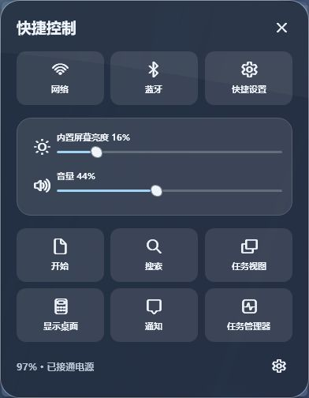
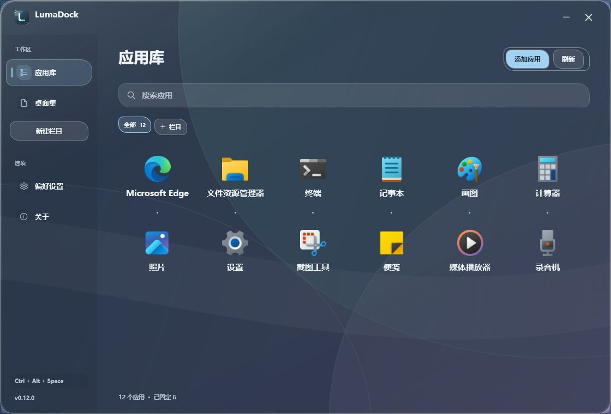

<p align="center">
  
</p>

<p align="center"><b>常用应用与系统控制，都在顺手的位置。</b></p>
<p align="center">
  <a href="https://github.com/FouHe0720/LumaDock/releases/tag/v0.12.0"></a>
  
  <a href="https://github.com/FouHe0720/LumaDock/actions/workflows/build.yml"></a>
  <a href="LICENSE"></a>
</p>
<p align="center">
  <a href="https://github.com/FouHe0720/LumaDock/releases/download/v0.12.0/LumaDock-0.12.0-win-x64.zip"></a>
</p>
<p align="center">完整解压即可运行 · 自带 .NET Runtime · 无需管理员权限 · 预发布</p>
<p align="center">
  <a href="docs/USER-GUIDE.md">使用指南</a> ·
  <a href="docs/RELEASE-0.12.0.md">本次更新</a> ·
  <a href="docs/DEVELOPMENT.md">开发文档</a> ·
  <a href="docs/performance.md">性能记录</a>
</p>

LumaDock 是一款原生 Windows Dock 与应用管理器。图标映在通透的底座上，指针经过时轻轻放大；应用库负责查找，桌面集保留熟悉的桌面入口。音量、亮度、输入方式和日期时间也能从 Dock 打开。


<table>
  <tr>
    <td width="33%" valign="top"><b>应用，伸手就到</b><br><br>固定、拖排、悬停放大与窗口切换。正在运行的应用临时加入，关闭窗口后退出。</td>
    <td width="33%" valign="top"><b>控制，集中在一处</b><br><br>独立的输入模式与键盘布局入口；网络、声音、电源合成一个区域，点击展开快捷控制。</td>
    <td width="33%" valign="top"><b>外观，按自己的习惯</b><br><br>三种轮廓、六款配色，自选玻璃浓度、倒影、字体与文字颜色。系统区的大小、粗细也可单独调整。</td>
  </tr>
</table>

## 0.12 · Dock 多了一点从容

Dock 尾部从左到右安排了五组入口：

| 入口 | 点击后 |
| --- | --- |
| 后台应用箭头 | 打开 Windows 原生后台托盘，使用真实应用菜单 |
| 中／英 | 对支持的输入法切换当前窗口的中文、英文输入模式 |
| 拼等布局标识 | 选择实际安装的输入法或键盘布局 |
| 网络 · 声音 · 电源 | 展开玻璃快捷控制，调整音量、静音与支持的内置屏幕亮度 |
| 时间与日期 | 打开月历、通知中心或日期时间设置 |

快捷控制也提供开始、搜索、任务视图、显示桌面和任务管理器入口。WLAN、蓝牙及系统完整快捷设置交由 Windows 打开，实际开关由系统处理。

<p align="center"></p>

恢复的 **应用库／桌面集** 分工明确：应用库包含已发现与手动添加的程序；桌面集筛选当前仍存在的桌面快捷方式。两页共用整理记录，同一应用的不同启动方式放进右键菜单。栏目继续由自己新建、重命名和删除。


<p align="center"><sub>0.12.0 Windows 实际界面 · 系统应用、隔离配置与原创示例背景。设备状态和输入标识随实际环境变化。</sub></p>

Dock 保留普通窗口层级：打开其他软件时，工作窗口在上方。返回桌面使用 Dock，或按 **Ctrl + Alt + Space** 打开应用库。

## 通透底座，清楚倒影

圆润的胶囊、交错的卵石、利落的轨道。悬停时，当前图标放大并抬起，相邻图标随之让位；倒影跟着变化，停稳后动画收住。

在偏好设置中，可以把底座浓度调低至 **2%**、倒影调高至 **85%**，再按壁纸明暗调整图标鲜艳度。清透背景使用系统合成，后方动态画面随之变化。也可以选择磨砂、静态材质，或减少玻璃流动。

**潮蓝 · 青瓷 · 琥珀 · 烟紫 · 玫瑰 · 石墨**，六款强调色用于按钮、选中状态与玻璃边缘。侧栏、栏目与应用名称可以跟随 Windows 字体，或独立选择字体、加粗、斜体与文字颜色。

## 三步开始

1. [下载 Windows 便携版](https://github.com/FouHe0720/LumaDock/releases/download/v0.12.0/LumaDock-0.12.0-win-x64.zip)，**完整解压**到准备长期保留的可写文件夹。
2. 双击 **LumaDock.exe**，等待首次扫描。便携包包含 .NET Desktop Runtime，普通使用无需 SDK、IDE、字体包或其他主题工具。
3. 点击左端 L 图标，或按 **Ctrl + Alt + Space** 打开应用库。右键常用应用 → **固定到 Dock**；没扫描到的程序通过“添加应用”选择路径。

`source.zip` 和 GitHub 自动生成的 Source code 供开发使用。源码构建需要 Windows x64 与 [.NET 10 SDK](https://dotnet.microsoft.com/download/dotnet/10.0)：

```powershell
git clone https://github.com/FouHe0720/LumaDock.git
cd LumaDock
.\scripts\build.ps1
.\scripts\test.ps1
.\scripts\start.ps1 -Launchpad
```

[完整构建与发布步骤 →](docs/DEVELOPMENT.md)

## 常用操作

| 想做什么 | 从这里开始 |
| --- | --- |
| 快速找桌面程序 | 左侧 **桌面集**，可搜索、启动或固定到 Dock |
| 把应用插到两个图标中间 | 拖到 Dock 的插入标记处，松开即可 |
| 把 Dock 应用放到桌面 | 拖到 Windows 桌面创建快捷方式，原文件和固定状态保留 |
| 切换、最小化或关闭应用窗口 | 点击运行图标，或打开其右键窗口菜单 |
| 更换应用图标 | 右键 → **更换图标…**，可随时恢复原图标 |
| 建立自己的栏目 | **新建栏目**，拖入应用；右键栏目可改名或删除 |
| 调整系统区图标、字号与粗细 | **偏好设置 → 系统状态区** |
| 调整字体、粗细与文字颜色 | **偏好设置 → 字体与文字** |
| 选择第二块屏幕 | **偏好设置 → Dock → 显示器** |
| 设置开机启动 | **偏好设置 → 性能与启动**，主动启用并确认 |
| 创建 LumaDock 桌面快捷方式 | 为解压目录中的 `LumaDock.exe` 创建快捷方式 |
| 完全退出 | Dock 空白处或托盘菜单 → **退出 LumaDock** |

LumaDock 保留 Windows 原任务栏与桌面设置。若选择自动隐藏任务栏，请在 Windows 的任务栏设置中操作；恢复时关闭该选项。系统托盘由 Windows 显示，外观沿用系统；第三方输入法不提供可读取的模式接口时，中／英按钮会显示不可用；外置显示器亮度接口目前不在自绘滑块控制范围内。详情见 [使用指南](docs/USER-GUIDE.md#dock-系统区)。

## 轻量驻留

**C# · .NET 10 LTS · WPF · Windows Shell。** 窗口状态、网络、电源与音频由事件更新，图标异步读取并缓存；亮度只在面板打开或用户操作时查询。时钟按分钟更新，Dock 隐藏后暂停。

图标倒影复用已有图像，鲜艳度处理结果使用有界缓存；悬停与反光停稳后停止动画。没有大型浏览器运行时，也没有额外后台服务。

Windows 11 两轮静置实测平均全机 CPU：Dock **0.0235%**，应用库前台 **0.0380%**。

私有工作集峰值分别 **56.527 / 77.938 MB**；私有提交为 **105.832 / 147.703 MB**，两者口径不同。

应用库首帧 **324.182 ms**，为进程内计时。两轮请求采样分别为 90 秒和 45 秒，不代替过夜驻留验收；完整条件、程序集校验值与未覆盖场景见 [性能记录](docs/performance.md) 和 [验证范围](docs/validation.md)。

## 数据与退出

配置和轮转日志保存在 `%LOCALAPPDATA%\LumaDock`。导出、导入和恢复默认值位于 **偏好设置 → 数据**。软件不主动上传配置或应用清单；扫描只读已注册的程序入口，不遍历整块磁盘。

开机启动通过当前用户启动文件夹中的快捷方式实现，启用前确认。卸载时先关闭开机启动、退出软件，再移除解压文件夹和 LumaDock 快捷方式。需要保留整理结果时保留数据目录。[完整退出、卸载与桌面恢复步骤 →](docs/USER-GUIDE.md#9-桌面图标恢复与卸载)

遇到问题，欢迎提交 [Issue](https://github.com/FouHe0720/LumaDock/issues)，写明版本、系统、缩放比例与复现步骤；分享截图或日志前请移除私人信息。

源码采用 [MIT License](LICENSE)。发行包附带微软 .NET Runtime 许可与第三方声明；运行时读取的应用名称与图标归各自所有者所有。
