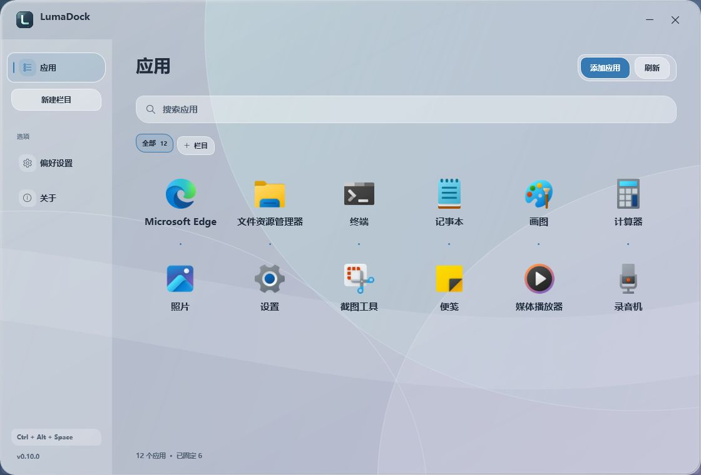
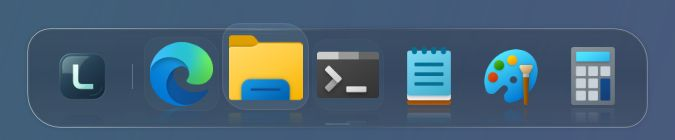
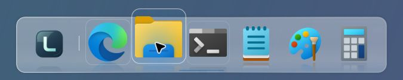

<p align="center">
  
</p>

<p align="center"><b>把常用应用留在顺手的位置。</b></p>
<p align="center">
  <a href="https://github.com/FouHe0720/LumaDock/releases"></a>
  
  <a href="https://github.com/FouHe0720/LumaDock/actions/workflows/build.yml"></a>
  <a href="LICENSE"></a>
</p>
<p align="center">
  <a href="https://github.com/FouHe0720/LumaDock/releases/download/v0.10.0/LumaDock-0.10.0-win-x64.zip"></a>
</p>
<p align="center">完整解压即可运行 · 无需额外安装 .NET · Windows 11 推荐 · 预发布</p>
<p align="center">
  <a href="docs/USER-GUIDE.md">使用指南</a> ·
  <a href="https://github.com/FouHe0720/LumaDock/releases/tag/v0.10.0">版本说明</a> ·
  <a href="docs/DEVELOPMENT.md">开发文档</a>
</p>

LumaDock 是一款原生 Windows Dock 与应用管理器。常用软件放进悬浮 Dock，其他入口集中在“应用”里。栏目由自己新建，倒影、玻璃、轮廓、配色和文字也可按习惯调整。



<p align="center"><sub>0.10 实际 WPF 界面，使用系统应用、隔离配置与原创示例背景。</sub></p>

<table>
  <tr>
    <td width="33%" valign="top"><b>常用应用，一步就到</b><br><br>悬停放大、真实运行指示、四边停靠。拖到插入标记处，放进任意两个图标之间。</td>
    <td width="33%" valign="top"><b>一个列表，栏目自选</b><br><br>重复入口合并，同一应用的启动方式收进右键菜单。栏目可以随时新建、改名或删除。</td>
    <td width="33%" valign="top"><b>外观由你决定</b><br><br>真实图标倒影、更通透的底座、三种轮廓与六款强调色。字体、粗细和文字颜色也能单独调整。</td>
  </tr>
</table>

## 让 Dock 有自己的轮廓

圆润的胶囊、交错的卵石、利落的轨道。图标在底座映出淡淡倒影；指针经过时，当前图标放大并轻轻抬起，相邻图标随之让位，倒影一起变化。停稳后，动画收住。

<table>
  <tr>
    <td width="50%" align="center"><br><sub>深色 · 卵石 · 潮蓝</sub></td>
    <td width="50%" align="center"><br><sub>浅色 · 轨道 · 青瓷</sub></td>
  </tr>
</table>

<p align="center"><sub>两张均为当前 0.10 发布程序集的真实 Dock 控件，使用系统图标与独立示例背景。</sub></p>

将桌面程序或快捷方式拖入 Dock，可直接选择插入位置；将 Dock 图标拖到 Windows 桌面，会创建真实快捷方式。原文件和 Dock 固定状态保留，需要取消固定时右键移除。

轮廓、位置、显示器、图标大小与悬停幅度，在 **偏好设置 → Dock** 中调整。图标倒影可单独开关、调整强度，省电与高对比度模式暂时关闭。底座的 **Dock 浓度** 可调为 15–100%，默认 70%；数值越低越通透，图标本身保持清楚。

## 玻璃随画面一起变化

默认 **动态透景 · 清透** 直接使用系统合成，后方动态壁纸随画面变化，保留玻璃边缘与短暂流光。喜欢更柔和的背景，可以切换磨砂；希望细节更清楚，可以调整窗口浓度。

**潮蓝 · 青瓷 · 琥珀 · 烟紫 · 玫瑰 · 石墨**，六款强调色用于按钮、选中状态与边缘反光。深浅主题、玻璃流动和界面动画可以分别选择。

在 **偏好设置 → 材质** 调整。动态模式不循环截取壁纸；静态折射按窗口事件取样。效果与系统支持条件见 [材质说明](docs/WINDOW-BACKDROP.md)。

## 字体清楚，读起来舒服

沿用 Windows 图标字体，或单独选择字体、名称字号、加粗与斜体。侧栏、栏目、标题和应用名称同步字体与粗细，各自保留合适的字号；大字号名称会自动调整网格密度。

文字颜色可以跟随主题、选择色板，也可以输入自己的十六进制色值。所有选项只影响 LumaDock。

<details>
<summary><b>查看字体与文字配色设置</b></summary>

字体、字号、粗细与颜色在同一处预览，修改后保存；也可以随时切回系统字体。

打开 **偏好设置 → 字体与文字**。沿用系统设置时保持“跟随 Windows 图标字体”开启；选择独立样式时关闭它，修改后即可预览并保存。[详细范围](docs/SYSTEM-FONTS.md)

</details>

## 三步开始

1. [下载 Windows 便携版](https://github.com/FouHe0720/LumaDock/releases/download/v0.10.0/LumaDock-0.10.0-win-x64.zip)，**完整解压**到准备长期保留的可写文件夹。
2. 双击 **LumaDock.exe**，等待首次扫描。便携包包含 .NET Desktop Runtime，无需安装 SDK、IDE、字体包或主题软件。
3. 按 **Ctrl + Alt + Space** 打开应用；右键应用 → **固定到 Dock**。未扫描的软件可通过“添加应用”选择程序或快捷方式。

普通使用不需要管理员权限。`source.zip` 和 GitHub 的 “Source code” 用于开发，不能直接作为程序运行。

<details>
<summary><b>常用操作与双屏设置</b></summary>

| 想做什么 | 从这里开始 |
| --- | --- |
| 打开应用 | 点击 Dock 左端 L 图标，或按 **Ctrl + Alt + Space** |
| 把应用插到中间 | 拖到 Dock 的目标位置，看到插入标记后松开 |
| 把 Dock 应用放到桌面 | 拖到 Windows 桌面，创建快捷方式，固定状态保留 |
| 栏目与排序 | 新建栏目，拖到栏目标签或右键放入；栏目可随时改名或删除 |
| 选择其他启动参数 | 右键应用或 Dock 图标 → **启动方式**，选择保留的入口 |
| 更换图标 | 右键应用 → **更换图标…**；可随时恢复原图标 |
| 换玻璃、主题和配色 | **偏好设置 → 材质** |
| 调整字体、粗细与文字颜色 | **偏好设置 → 字体与文字** |
| 选择第二块屏幕 | **偏好设置 → Dock → 显示器**，选择目标屏幕 |
| 开机启动 | **偏好设置 → 性能与启动**，主动启用并确认 |
| 完全退出 | 托盘菜单 → **退出 LumaDock** |

**应用**统一呈现开始菜单、桌面、AppsFolder 注册入口和手动添加的程序，不再分成两个页面。初次使用没有默认分类；点击“新建栏目”，按自己的习惯整理。栏目右键可重命名或删除，应用右键可放入栏目或取消归属。

重复快捷方式按真实启动目标和系统标识合并。同名且指向同一本地程序的不同启动方式集中在一张卡片，原始参数与工作目录保留；右键 **启动方式** 即可选择。不同程序、网页、协议和打包应用身份仍分别保留，名称相同本身不会导致合并。

已确认失效的入口暂不显示，原有图标、栏目与固定记录保留，程序恢复后可重新出现。扫描覆盖开始菜单、桌面与 AppsFolder 注册入口，不遍历整块磁盘；未注册的便携软件需要手动添加。

快捷方式、自启、配置备份、正常卸载与恢复 Windows 桌面的完整步骤，见 [使用指南](docs/USER-GUIDE.md)。

</details>

## 轻量驻留，有实测依据

界面采用 **C# · .NET 10 LTS · WPF · Windows Shell**。动态透景交给系统合成，图标与流光停稳后停止动画，窗口状态通过 Windows 事件更新。

倒影直接复用图标缓存，经过裁切和渐隐绘制，不另存图标副本。悬停、反光与输入光标按各自事件更新，静止时不维持动画循环。具体测试环境、版本、二进制与资源实测见 [性能记录](docs/performance.md)。

| 0.10 实测 | 平均 CPU（全机） | 私有工作集峰值 |
| --- | ---: | ---: |
| Dock 静置 | 0.0000% | 62.8 MB |
| 应用窗口前台、搜索聚焦 | 0.0015% | 67.8 MB |

应用窗口首帧 **272 ms**，为应用内计时。以上在 Windows 11、16 个逻辑处理器下测量：6 个真实固定应用、倒影开启，各静置采样 60 秒；不代表持续悬停的峰值或长期驻留结果。完整口径与原始记录见 [性能记录](docs/performance.md)。

当前为预发布版本。目标为 Windows 10 / 11 x64，推荐 Windows 11；已验证环境、跨桌面鼠标操作与混合 DPI 等边界见 [验证范围](docs/validation.md)。

<details>
<summary><b>从源码构建</b></summary>

在 Windows x64 上安装项目指定的 .NET 10 SDK，然后从项目根目录运行：

```powershell
.\scripts\build.ps1
.\scripts\test.ps1
.\scripts\start.ps1 -Launchpad
```

SDK 版本、安装方式、项目结构及完整测试命令见 [开发文档](docs/DEVELOPMENT.md)。WPF 正式编译与桌面验收需要 Windows 环境。

</details>

## 文档与反馈

[完整使用指南](docs/USER-GUIDE.md) · [字体与文字](docs/SYSTEM-FONTS.md) · [版本说明](docs/RELEASE-0.10.md) · [性能记录](docs/performance.md) · [开发文档](docs/DEVELOPMENT.md)

配置与日志保存在 `%LOCALAPPDATA%\LumaDock`，不主动上传。启用开机启动或改变桌面图标显示时会单独确认。

0.10 会将旧配置升级为格式 2。升级前建议导出备份；回退旧版时使用升级前备份或独立数据目录，避免旧程序覆盖新配置。[升级说明](docs/USER-GUIDE.md#从旧版本升级)

遇到问题，欢迎提交 [Issue](https://github.com/FouHe0720/LumaDock/issues)，写明系统版本、缩放比例与复现步骤；分享日志或截图前请移除私人信息。

源码采用 [MIT License](LICENSE)。发行包附带微软 .NET Runtime 许可与第三方声明；运行时读取的应用图标归各自权利人所有。
