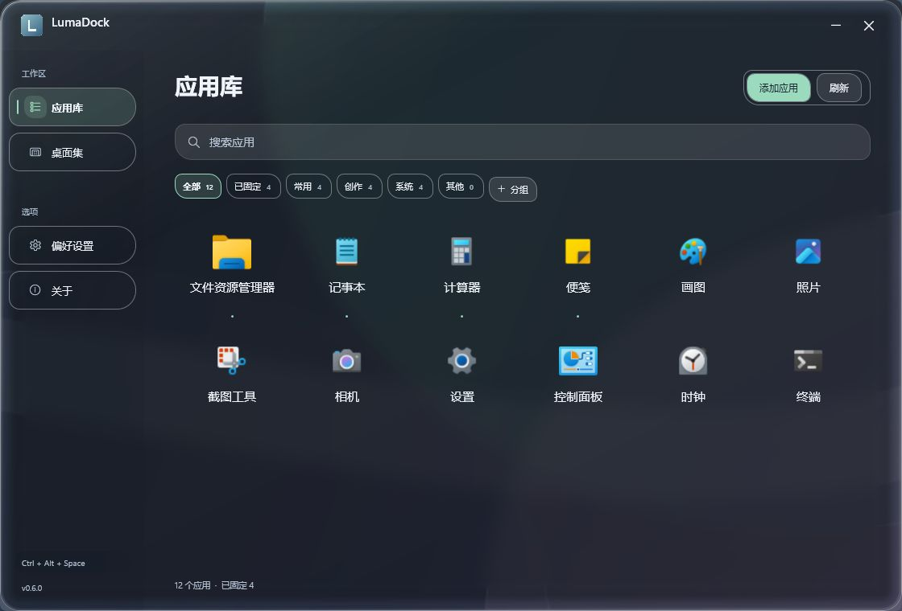
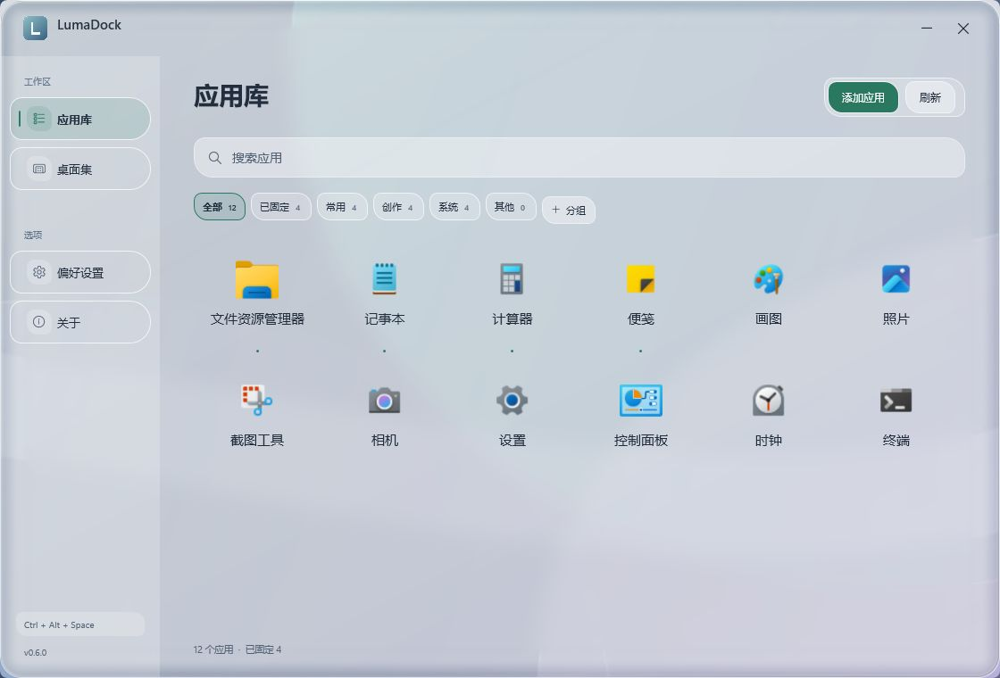
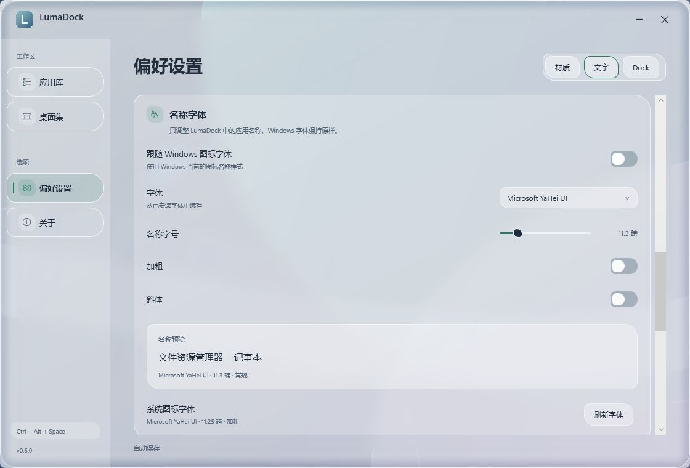

  

<h1 align="center">LumaDock</h1>

把常用应用留在顺手的位置。

  
  
  
  

  <a href="https://github.com/FouHe0720/LumaDock/releases"><b>下载 Windows 版</b></a> ·
  <a href="docs/USER-GUIDE.md">使用指南</a> ·
  <a href="docs/DEVELOPMENT.md">开发文档</a>

LumaDock 是一款原生 Windows Dock 与应用管理器。悬浮 Dock 放置常用入口，应用库集中查找和整理软件；玻璃、颜色和名称字体都可以按习惯调整。

界面示例；应用内容取决于实际安装与整理结果。

查看浅色界面

## 功能一览

| 常用入口 | 应用整理 | 外观与文字 |
| --- | --- | --- |
| 悬浮 Dock、拖动排序、真实运行指示 | 应用搜索、虚拟分组、桌面快捷方式 | 背景折射、短暂流光、深浅主题 |
| 点击启动或切换已有窗口 | 新增路径、固定到 Dock、隐藏记录 | 四种强调色、自选字体与字号 |
| 自动隐藏、四边停靠、显示器选择 | 排列与分类自动保存 | 预览后保存，随时调整 |

采用 C#、.NET 10 LTS、WPF 与 Windows Shell。界面使用原生桌面技术，不依赖浏览器运行时或后台服务。Dock 空闲时不持续播放动画；关闭动态透景后仍可保留按事件更新的玻璃效果。

## 下载后直接运行

1. 打开 [Releases](https://github.com/FouHe0720/LumaDock/releases)，下载名称以 **`win-x64.zip`** 结尾的便携包。
2. **完整解压**到可写、准备长期保留的文件夹。
3. 双击 **`LumaDock.exe`**。首次扫描完成后，Dock 和应用库即可使用。

便携包包含 .NET Desktop Runtime，**无需另外安装 .NET、SDK、IDE、字体包或主题包**。普通使用不需要管理员权限。`source.zip` 与 GitHub 的 “Source code” 用于开发，不是可直接运行的程序包。

目标平台为 Windows 10 / 11 x64，推荐 Windows 11。不同系统的玻璃效果会按支持条件回退；当前仍为预发布版本，兼容性覆盖见 [验证记录](docs/validation.md)。

## 五分钟上手

| 想做什么 | 从这里开始 |
| --- | --- |
| 打开应用库 | 点击 Dock 最左侧图标，或按 **Ctrl + Alt + Space** |
| 放入常用软件 | 在应用库右键软件 → **固定到 Dock** |
| 添加未扫描的软件 | 点击 **添加应用**，选择程序或快捷方式 |
| 分类与排序 | 新建分组，将应用拖到分组标签；拖到另一应用前调整顺序 |
| 换配色和玻璃 | **偏好设置 → 材质** |
| 调整名称字体 | **偏好设置 → 文字**，关闭跟随系统后选择字体与字号 |
| 选择第二块屏幕 | **偏好设置 → Dock → 显示器** |
| 完全退出 | 托盘菜单 → **退出 LumaDock** |

**应用库**汇集开始菜单、注册应用、桌面和手动添加的应用；**桌面集**单独呈现桌面应用快捷方式。两页可以显示同一软件，分组与固定状态共享。整理只改变管理记录，不移动原文件。

## 让文字适合自己的眼睛

名称字体可以跟随 Windows 图标字体，也可以单独选择字体、字号、加粗与斜体。下方即时预览，大字号会自动调整网格密度。

这些选项只影响 LumaDock 中的应用名称和 Dock 提示，不改变 Windows 全局字体。配色提供 **潮蓝、青瓷、琥珀、烟紫**；流光、动态透景和界面动画可以分别调整。

## 继续了解

- [完整使用指南](docs/USER-GUIDE.md)：依赖、快捷方式、Dock、分组、双屏、自启、备份、退出与卸载。
- [名称字体](docs/SYSTEM-FONTS.md)：手动调节、系统跟随与显示范围。
- [开发与构建](docs/DEVELOPMENT.md)：Windows 环境、命令构建、测试和便携发布。
- [性能记录](docs/performance.md) · [验证范围](docs/validation.md) · [版本说明](docs/RELEASE-0.6.md)。

配置和日志保存在 `%LOCALAPPDATA%\LumaDock`，不主动上传。启用开机启动或更改桌面图标显示时会单独确认。恢复原有桌面、退出和卸载方法均可在使用指南中查到。

## 开源与许可

项目源码采用 [MIT License](LICENSE)。发行包附带微软 .NET Runtime 许可与第三方声明；应用图标在运行时读取已安装软件的真实资源，权利归各自所有者。

欢迎通过 [Issues](https://github.com/FouHe0720/LumaDock/issues) 反馈问题。提交时请写明系统版本、缩放比例、复现步骤，并移除日志或截图中的私人信息。
