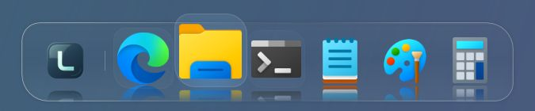

# LumaDock 0.10.1

倒影再清楚一点，图标再亮一些，底座可以更通透。

展示图来自本版真实发布程序集，倒影 72%、底座浓度 4%、图标鲜艳度 50%，使用系统图标与独立示例背景。

## 倒影更明显

**偏好设置 → Dock → 倒影强度** 的上限由 50% 提高到 **85%**。镜面向外渐隐的范围更长，图标悬停抬起时也保留更清楚的倒影。默认仍为 24%，已有选择保留；省电或高对比度模式暂时关闭倒影。

## 图标鲜艳度

Dock 设置新增 **图标鲜艳度**，范围为 **0–100%**，默认 28%。提高数值会提亮图标、增加色彩；倒影使用同一张图像，颜色一起变化。设为 0% 即可保留原色。

此项只影响 Dock 的显示，不改变应用列表、Windows 桌面、图标文件或图像的透明边缘。高对比度模式使用原始颜色。

## 更通透的底座

**偏好设置 → 材质 → Dock 浓度** 的下限由 15% 降到 **2%**，低浓度时底色也更轻。默认仍为 70%，数值越低越透明；图标本身保持清楚。管理窗口的“窗口浓度”继续独立调整。

倒影直接复用显示中的图标图像，不另生成镜像位图。鲜艳度在图标加载或设置改变后处理并缓存，空闲时不重复计算；图标和流光停稳后停止动画。

## 使用与升级

完整解压 **LumaDock-0.10.1-win-x64.zip**，运行 **LumaDock.exe**。便携包自带 .NET Desktop Runtime，无需另装 SDK 或 IDE；**Ctrl + Alt + Space** 打开应用。

沿用 0.10 的配置格式 2、统一应用列表与自建栏目。升级前可在“偏好设置 → 数据”导出备份；回退到 0.9 需要使用旧格式备份或独立数据目录。

本版 Release 解决方案 19 个项目构建通过，0 警告、0 错误；237 项组件与 WPF 检查、100 次窗口开合和搜索通过。其中 Dock 79 项、设置与文字界面 48 项，覆盖真实像素、颜色缓存、透明边缘、四边倒影及设置保存。Explorer / Windows 桌面的完整跨窗口物理拖动仍列为手工验收，未把组件检查当作全流程验收。

6 个真实固定应用、倒影 72%、底座浓度 4%、鲜艳度 50% 下，两轮各测 60 秒 Dock 静置：预热 30 秒后平均全机 CPU 0.1846%、私有工作集峰值 54.0 MB；预热 120 秒后为 0.0065%、51.4 MB。首轮有一次采样 CPU 1.6437%，原因尚未量化判定，两轮均保留。数据来自 Windows 11、16 个逻辑处理器，不代表持续拖动、GPU 或长期驻留；本次未复测应用窗口前台。

当前仍为预发布版本。具体构建、交互、资源实测与兼容性边界见 [验证记录](validation.md) 和 [性能记录](performance.md)，完整操作见 [使用指南](USER-GUIDE.md)。
