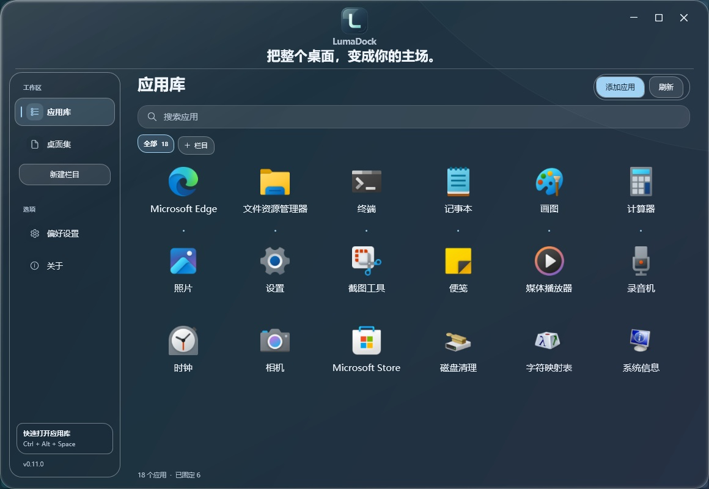

# LumaDock 0.11.0

**把整个桌面，变成你的主场。**

[使用指南](USER-GUIDE.md) · [验证范围](validation.md) · [性能记录](performance.md)

## 重新展开的工作台

Logo 移到窗口上方中央，下方是一句简洁的项目介绍。独立圆角侧栏整理好应用库、桌面集与自建栏目，搜索和操作区保持清楚的层次，内容网格获得更完整的空间。

默认窗口为 1160×800。1120×760、每行 6 个、15 DIP 名称字号下仍能显示三排六列；大字体与小窗口按实际空间调整，保留两行名称。四边和四角支持拉伸，右上角补齐最大化与还原，顶部品牌区的空白处可拖动窗口、双击切换最大化。

## 随手摆放 Dock

拖住握柄或底座空白处，便能把整个 Dock 移到想放的位置；应用图标的拖动继续用于排序。自由位置在松开时保存，刷新应用、重启或调整底座尺寸后，按显示器工作区恢复。

跨屏移动会记录落点所在屏幕，屏幕断开时回到主屏。工作区或缩放变化后，位置重新限制在可见范围内。拖动期间不逐帧写配置，不增加持续的后台位置轮询。

“偏好设置 → Dock”新增 **摆放方式**，可选择自由摆放或四边停靠。改变 **位置** 会恢复四边停靠；自由模式暂时停用自动隐藏，原偏好保留，回到停靠后继续生效。

双击握柄或底座空白处、使用 Dock 右键菜单 **恢复底部居中**，或点击设置中的 **恢复位置**，即可回到所选屏幕底部。恢复只调整位置，保留显示器选择、图标顺序与其他外观。

Dock 继续使用普通窗口层级，其他工作窗口保持在上方。真实运行标记、窗口切换、悬停放大、倒影与颜色设置继续使用原有行为。

## 原有整理结果继续使用

应用库仍支持搜索、批量添加和自建栏目。桌面集继续显示实际桌面中的文件夹、文档、图片与快捷方式，可双击打开、右键新建、改名和复制文件副本；页面通过目录事件更新。

本版沿用配置格式 2，增加 Dock 摆放方式及相对位置字段。已有配置默认四边停靠，原固定项、自选图标、栏目和外观偏好继续保留。文件夹复制、其他文件模板、删除与完整 Shell 菜单仍可通过“打开桌面”使用资源管理器。

## 下载与记录

下载 **LumaDock-0.11.0-win-x64.zip**，完整解压后双击 **LumaDock.exe**。便携包包含 .NET Desktop Runtime，无需另装 SDK 或 IDE。源码包供开发使用。

本版通过 316 项组件与 WPF 检查，另有 14 组导入、100 轮窗口生命周期，以及真实鼠标窗口拉伸、Dock 拖动和位置保存验收，详见[验证范围](validation.md)。

最终程序在 Windows 11 上的短时静置实测：自由 Dock 私有工作集峰值 58.8 MB，有限采样未记录到 CPU 计时增量；应用库前台平均全机 CPU 约 0.003%，私有工作集峰值 65.2 MB。两轮均请求采样 30 秒，CPU 零值不表示绝对零开销，也不代表连续操作或长期驻留表现。条件、首帧和二进制校验见[性能记录](performance.md)。
