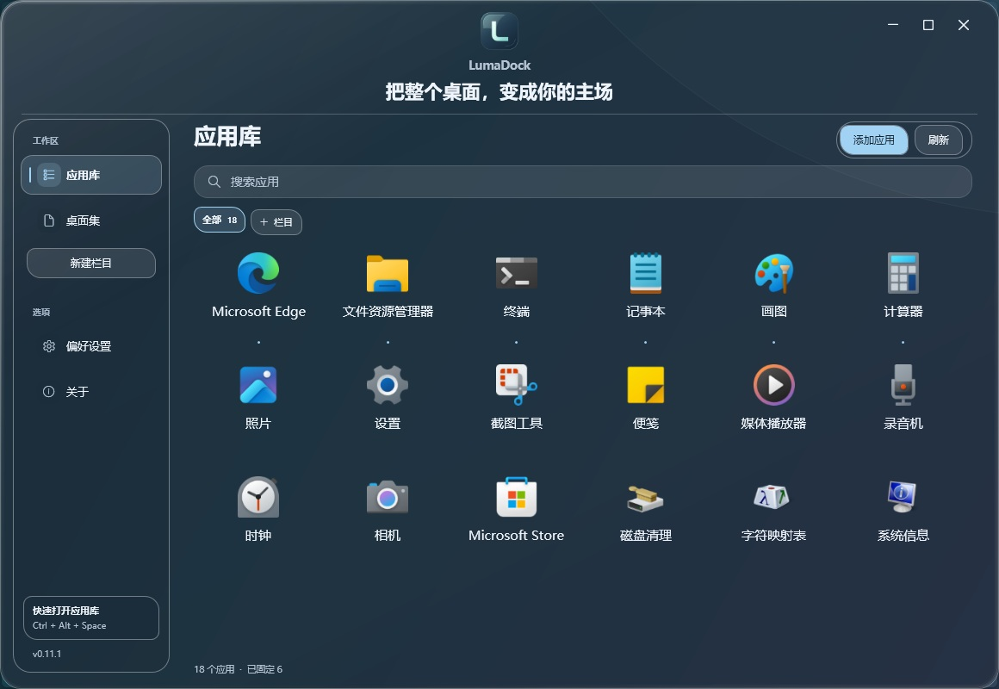

# LumaDock 0.11.1

**把整个桌面，变成你的主场**

[使用指南](USER-GUIDE.md) · [验证范围](validation.md) · [性能记录](performance.md)

## 更舒展的顶部

Logo、LumaDock 名称和项目介绍分别对齐窗口中线。上下两段间距都扩大到 8 DIP，介绍语保持 22 DIP，去掉句末标点，让三项的视觉中心更一致。侧栏、应用库、桌面集和可拉伸窗口继续保留。

## 文件夹，也可以放进 Dock

把本机实际文件夹，或指向它的快捷方式拖到底座，在插入标记处松开。也可以在桌面集中右键文件夹，选择 **固定到 Dock**。点击后由 Windows 打开真实目录。

只登记入口，不移动、复制目录或扫描内部文件。文件夹与其快捷方式按目标路径整理，不混入应用库，也不显示程序运行胶囊。取消固定保留原目录；目标暂时不可用时保留整理结果，恢复后可以刷新。没有实际目录的虚拟系统文件夹不在此功能范围内。

## 每行，最多 20 个

**偏好设置 → 应用整理 → 每行应用数** 保留 4～10 个，新增 **12、14、16、18、20 个**。内容区随选择使用更宽空间，20 列需要足够宽的窗口；较小窗口或大字号仍自动减少实际列数，为名称保留可读空间。

重名提示索引在目录重建时集中生成，创建卡片时不再逐张遍历完整应用清单。搜索继续复用现有目录缓存，没有增加后台扫描或位置轮询。

## 自由摆放，延伸到任务栏区域

拖住 Dock 握柄或底座空白处，现在可以移入任务栏占用的坐标区域；松开后按完整显示器范围保存。四边停靠仍沿系统工作区摆放，旧版自由位置在升级时保留，再次拖动后使用新范围。

Dock 继续处于普通窗口层级，Windows 任务栏可能遮住重叠部分。软件不修改任务栏显示或系统设置；被遮住时按 **Ctrl + Alt + Space** 打开应用库，在 **偏好设置 → Dock → 恢复位置** 找回。双击握柄或底座空白处也可恢复底部居中。

## 下载与记录

下载 **LumaDock-0.11.1-win-x64.zip**，完整解压后双击 **LumaDock.exe**。便携包包含 .NET Desktop Runtime，无需另装 SDK 或 IDE，原有固定项、自选图标、栏目和外观继续保留。

Windows 验证通过 **336 项组件与 WPF 检查**，另有 14 组导入与 100 轮窗口生命周期。目录固定使用实际文件、Shell 图标、WPF 拖放数据对象和存储检查；完整显示器位置使用真实 HWND 与几何夹具，不将这些结果当作 Explorer 跨窗口物理鼠标拖放或长期驻留保证。

最终程序在 Windows 11 的短时实测中，自由 Dock 私有工作集峰值 **49.0 MB**；应用库实际最大化、每行 20 个时为 **95.0 MB**。两轮有限采样均未记录到 CPU 计时增量，不代表绝对零开销或长期保证。固定项包含 2 个程序与 1 个实际文件夹，倒影 90%、底座浓度 4%，分别预热 20 秒和 120 秒后请求采样 30 秒。普通窗口及验收交互的另两轮诊断也完整保留；条件、首帧、校验值和未覆盖环境见[验证范围](validation.md)和[性能记录](performance.md)。